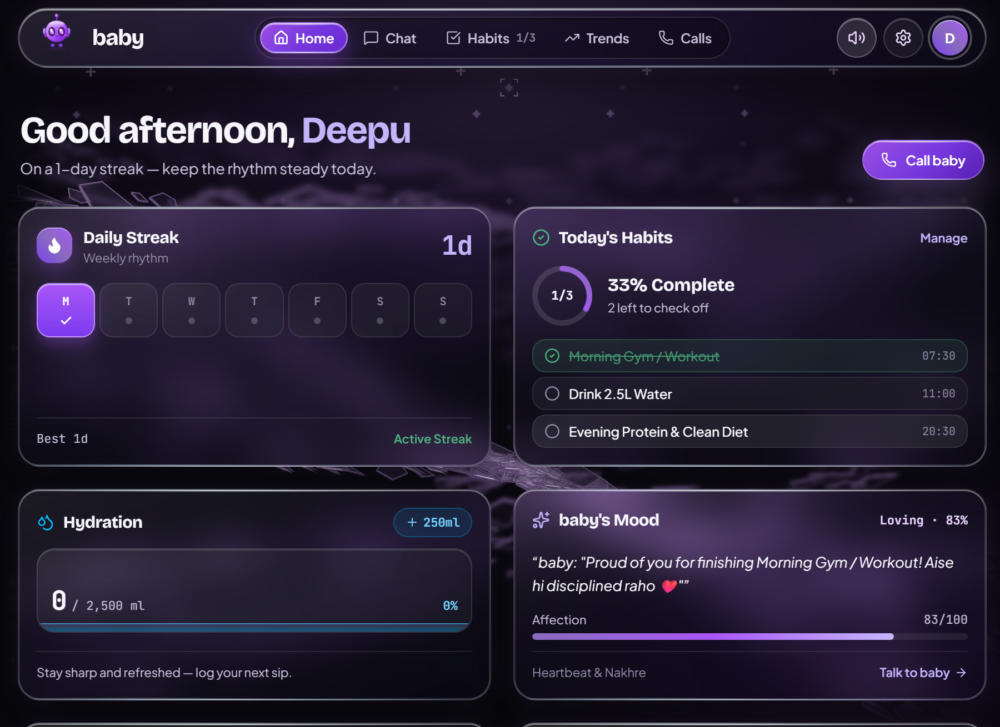
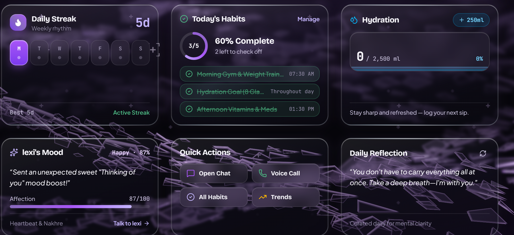
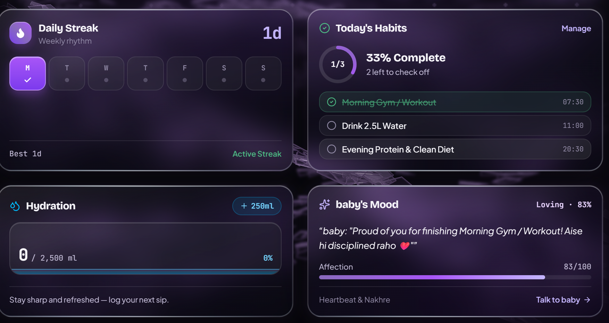
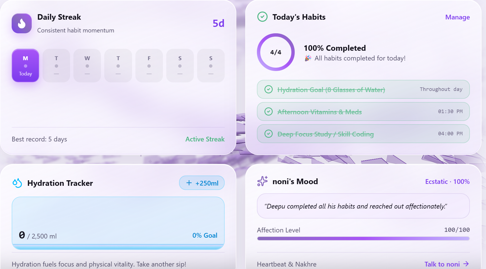
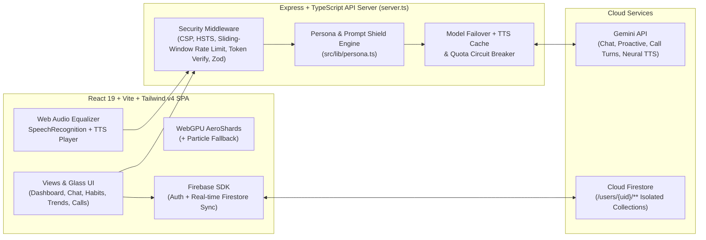

<div align="center">


# Lexi: Your AI SoulSync

**Hyper-personalized AI virtual companion & daily habit accountability platform**  
*Emotional intelligence, multimodal Hinglish/Hindi/English chat, live voice calls, hydration & streak tracking, and WebGPU liquid-glass aesthetics.*

[](https://react.dev/)
[](https://www.typescriptlang.org/)
[](https://tailwindcss.com/)
[](https://expressjs.com/)
[](https://firebase.google.com/)
[](#testing--verification)

<br />



</div>

---

## Overview

**Lexi: Your AI SoulSync** blends an emotionally responsive AI companion with a disciplined daily habit, hydration, and routine tracker. Instead of passive checklists, your companion adapts to your chosen relationship dynamic (*Sweet & Loving*, *Playful Bestie*, *Disciplined Coach*, or *Calm Soulmate*), remembers personal context in a dedicated Memory Vault, reacts to your streak momentum with live mood & affection telemetry, and supports real-time voice conversations with audio visualization.

---

## Visual Showcase

### Full Bento Dashboard & Interactive WebGPU Canvas
> Specular obsidian-slate frosted glass cards layered over real-time interactive WebGPU `AeroShards` geometry with automatic 2D Canvas fallback.



### Dark & Light Frosted Glass Themes

<table>
  <tr>
    <td width="50%" align="center">
      <strong>Dark Smoked Liquid Glass</strong><br /><br />
      
    </td>
    <td width="50%" align="center">
      <strong>Light Lavender Frosted Glass</strong><br /><br />
      
    </td>
  </tr>
</table>

---

## Key Features

### 1. Emotionally Responsive Companion & Persona Engine
- **4 Distinct Relationship Dynamics:** Switch seamlessly between *Sweet & Loving*, *Playful Teasing*, *Disciplined Coach*, and *Calm Soulmate* — each enforcing strict persona boundaries and tone consistency.
- **Script-Mirrored Multilingual Chat:** Automatically detects and mirrors **Devanagari Hindi**, **Roman Hinglish**, and **English**, with accurate masculine/feminine Hindi grammatical agreement based on companion gender.
- **Dynamic Mood & Affection System:** Tracks companion mood (`ecstatic`, `loving`, `happy`, `neutral`, `annoyed`, `angry`), affection score (`0–100`), and playful *nakhre* level in response to habit wins, missed goals, and conversations.
- **Automatic Habit Detection in Chat:** Saying *"Just finished gym and drank water"* naturally detects and logs habit progress right from conversation.

### 2. Daily Habit, Streak & Hydration Accountability
- **Timezone-Aware Streak Engine:** Accurate `YYYY-MM-DD` date tracking across IANA timezones with Monday-start weekly rhythm tiles, crucial-habit streak validation, and future-day protection.
- **Interactive Hydration Tracker:** One-tap `+250ml` quick logging with animated liquid-level fill, confetti celebrations, and Firestore-synced `waterLogs`.
- **Trends & Analytics:** Visual completion trends, weekly consistency charts (`Recharts`), and daily reflections.

### 3. Live Voice Calls & Resilient Dual-Layer TTS
- **Interactive Live Voice Call Modal:** Real-time speech recognition (`en-IN` tuned for Hinglish & English), live 16-band Web Audio API microphone frequency equalizer, and call history summaries.
- **Gemini TTS + Web Speech Fallback:** Server-side Gemini neural voice synthesis (`Kore`, `Aoede`, `Leda`, `Zephyr`, `Puck`, `Fenrir`) with in-memory audio caching, secondary model fallback, and automatic quota-aware fallback to browser Speech Synthesis.

### 4. Memory Vault & Ecosystem Sync
- **Personal Memory Vault:** Curated facts categorized by `health`, `exam`, `preference`, `relationship`, and `goal` that enrich every chat and voice call.
- **Schedule & Reminder Sync:** Track upcoming exams, meetings, workouts, and device alarms with proactive companion nudges (`miss_you`, `habit_reminder`, `calendar_alert`).

### 5. Liquid-Glass Design System & Typography
- **Custom Frosted Glass Surfaces:** Layered specular highlights, `backdrop-filter: blur(40px–52px)`, cool slate-indigo obsidian dark mode, and lavender daylight mode.
- **Editorial Font Pairing:** `Bricolage Grotesque` display headings, `Plus Jakarta Sans` UI copy, and `JetBrains Mono` tabular numerals.
- **Adaptive Responsive Navigation:** Floating liquid-glass desktop navigation rail and detached-orb floating mobile dock.

---

## Architecture



---

## Tech Stack

| Layer | Technologies |
| :--- | :--- |
| **Frontend** | React 19, TypeScript 5.8, Vite 6, Tailwind CSS v4, Motion (`motion/react`), Lucide Icons, Recharts, Canvas Confetti |
| **Graphics & Audio** | WebGPU (`vgpu` / WGSL `AeroShards`), Web Audio API (`AnalyserNode`), Web Speech API (`SpeechRecognition` & `SpeechSynthesis`) |
| **Backend** | Node.js 22, Express 4, `tsx`, Zod v4 request validation, `@google/genai` SDK |
| **Database & Auth** | Firebase Authentication (Google OAuth + Guest/Anonymous) & Cloud Firestore real-time listeners |
| **Testing & Build** | Node Test Runner (`tsx --test`), Vite Production Bundler, `esbuild` server bundler |

---

## Project Structure

```text
.
├── server.ts                     # Express API server, security headers, rate limiter, Gemini proxy & Vite middleware
├── index.html                    # Entry HTML with Google Fonts & OpenGraph metadata
├── firestore.rules               # Owner-isolated Firestore security rules & schema validators
├── firebase-blueprint.json       # Complete Firestore entity & collection schema specification
├── security_spec.md              # Security invariants & attack-vector defense matrix
├── docs/
│   └── screenshots/              # Verified application screenshots for documentation
├── public/
│   ├── icon.svg                  # App icon
│   └── manifest.json             # Web App Manifest (PWA metadata)
├── src/
│   ├── App.tsx                   # Application shell, state orchestration & Firestore real-time subscriptions
│   ├── index.css                 # Tailwind v4 theme tokens & liquid-glass utility classes
│   ├── types.ts                  # Shared TypeScript interfaces
│   ├── lib/
│   │   ├── firebase.ts           # Firebase Auth, Firestore CRUD/subscriptions & GDPR account erasure
│   │   ├── persona.ts            # Dynamic companion persona prompts, script detection & offline fallbacks
│   │   └── moods.tsx             # Companion mood context & transient reaction state
│   ├── utils/
│   │   ├── speech.ts             # Dual-layer Gemini TTS / Web Speech player, cooldown guard & mic equalizer
│   │   ├── streak.ts             # Timezone-aware streak & weekly rhythm calculator
│   │   └── id.ts                 # Collision-safe ID generation & deduplication helpers
│   └── components/
│       ├── AeroShards.tsx        # Interactive WebGPU glass shard background
│       ├── AtmosphericBackground.tsx
│       ├── Header.tsx            # Floating liquid-glass desktop navigation bar
│       ├── BottomTabBar.tsx      # Floating liquid-glass mobile dock + call orb
│       ├── DashboardView.tsx     # Bento dashboard (Streak, Habits, Hydration, Mood, Quick Actions, Reflection)
│       ├── ChatView.tsx          # Multimodal companion chat with voice input & message search
│       ├── TodosView.tsx         # Habit manager with categories, increments & crucial flags
│       ├── StatsView.tsx         # Weekly trends & hydration/habit analytics
│       ├── CallsView.tsx         # Voice call history & replayable summaries
│       ├── LiveCallModal.tsx     # Real-time voice call experience with live equalizer
│       ├── MemoryVaultView.tsx   # Learned companion memory manager
│       ├── EcosystemSyncView.tsx # Calendar & alarm routine sync
│       ├── SettingsModal.tsx     # Companion persona, voice, schedule, theme & privacy controls
│       ├── LoginModal.tsx        # Google OAuth, Email & Guest sign-in modal
│       └── ui/                   # Reusable GlassCard, GlassButton, ProgressRing, Chip, Modal, Skeleton
└── tests/
    ├── api-security.test.ts      # Live API, rate limit, CSP, IDOR, Zod & TTS contract tests
    ├── client-state.test.ts      # State deduplication, mood normalization & zero-value invariant tests
    ├── persona.test.ts           # Prompt shielding, gender grammar & relationship dynamic tests
    └── streak-and-data.test.ts   # Timezone date shifting, weekly rhythm & streak calculation tests
```

---

## API Reference

All AI operations execute server-side through `/api/*` so API credentials never reach the browser.

| Method | Endpoint | Purpose |
| :--- | :--- | :--- |
| `GET` | `/api/health` | Server health, uptime, active Gemini model candidates, memory metrics & config check |
| `POST` | `/api/chat` | Context-aware companion chat with mood updates, habit detection & memory extraction |
| `POST` | `/api/proactive` | Generates proactive nudges (`miss_you`, `habit_reminder`, `calendar_alert`, `morning_checkin`) |
| `POST` | `/api/call-turn` | Low-latency spoken conversational turns tailored for live voice calls |
| `POST` | `/api/tts` | Neural TTS synthesis with audio caching, model fallback & quota cooldown reporting |

---

## Security & Privacy

- **Strict Data Isolation:** All Firestore documents live under `/users/{userId}/**` with `request.auth.uid == userId` enforcement and `allow list: if false` on root `/users`.
- **Server Hardening:** Enforces `256kb` JSON payload limits, OWASP response headers (`CSP`, `HSTS`, `X-Content-Type-Options`, `X-Frame-Options`, `Permissions-Policy`), sliding-window rate limiting (`60 req/min` per IP, `30 req/min` per UID), Bearer token validation with cross-user IDOR rejection, and Zod schema validation.
- **Prompt Injection Shielding:** Untrusted chat inputs and memory/event strings are sanitized and wrapped in explicit `<security_boundary>` delimiters.
- **Right to Erasure:** Built-in account deletion clears all user Firestore subcollections, local storage, and auth credentials.

See [`security_spec.md`](security_spec.md) and [`firestore.rules`](firestore.rules) for full security invariants.

---

## Getting Started

### Prerequisites
- **Node.js** `>= 20` (tested on Node `v22`)
- **npm** (or compatible package manager)
- A **Gemini API Key** (free or billed tier)
- A configured **Firebase project** (`firebase-applet-config.json`) for Authentication & Cloud Firestore

### 1. Clone & Install
```bash
git clone <your-repository-url>
cd lexi-ai-soulsync
npm install
```

### 2. Configure Environment Variables
Copy `.env.example` to `.env` and add your server-side Gemini API key:
```bash
cp .env.example .env
```

```env
GEMINI_API_KEY="your_gemini_api_key_here"
APP_URL="http://localhost:3000"
```

### 3. Run Locally (Development)
Starts the Express backend with Vite middleware on `http://localhost:3000`:
```bash
npm run dev
```

### 4. Production Build & Start
Compiles the Vite SPA to `dist/` and bundles `server.ts` to `dist/server.cjs`:
```bash
npm run build
npm start
```

---

## Testing & Verification

Run the TypeScript compiler check and full automated test suite (with the server running on port `3000`):

```bash
# Type-check all client and server TypeScript code
npm run lint

# Execute all 4 test suites (60 tests across 23 sub-suites)
npm test
```

### Latest Verified Test Coverage
| Test Suite | Scope | Status |
| :--- | :--- | :---: |
| `tests/api-security.test.ts` | Health check, OWASP headers, Zod 400 validation, IDOR 403 blocking, guest UID reconciliation, `/api/chat`, `/api/proactive`, `/api/call-turn`, `/api/tts` | Passing |
| `tests/client-state.test.ts` | ID deduplication, `stripUndefined`, mood normalization, voice/profile sync & zero-value nullish invariants | Passing |
| `tests/persona.test.ts` | Prompt injection shielding, Hindi gender grammar, 4 relationship dynamics, voice call constraints & script mirroring | Passing |
| `tests/streak-and-data.test.ts` | Clean production defaults, timezone `YYYY-MM-DD` calculations, leap-day shifts, weekly rhythm & streak rules | Passing |

---

## Available Scripts

| Script | Description |
| :--- | :--- |
| `npm run dev` | Starts Express + Vite development server on port `3000` |
| `npm run build` | Builds frontend (`vite build`) and bundles Express server (`esbuild`) |
| `npm start` | Runs the compiled production server (`node dist/server.cjs`) |
| `npm run lint` | Runs strict TypeScript type-checking (`tsc --noEmit`) |
| `npm test` | Runs all unit, persona, streak, and API security tests (`tsx --test`) |

---

<div align="center">
  <sub>Built with React 19, TypeScript, Tailwind CSS v4, Express, Firebase, and Gemini AI.</sub>
</div>
